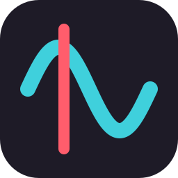

<p align="center">
  
</p>

<h1 align="center">Overtone</h1>

<p align="center">
  <b>Automatic timing for osu! maps.</b> Drop in a song and get its BPM, offset and every red line in minutes, ready to map.<br/>
  Live at <a href="https://overtone.midesprojects.com"><b>overtone.midesprojects.com</b></a> · part of <a href="https://midesprojects.com">Mides Projects</a>
</p>

<p align="center">
  
  
  
</p>

---

## What is it?

Timing is the first and most tedious step of making an osu! beatmap: finding the BPM,
the exact offset of the first beat, and a new red line wherever the tempo or the meter
changes. Overtone listens to the song and does that for you, then lets you check the
result by ear before you start mapping.

It is a free website, **[overtone.midesprojects.com](https://overtone.midesprojects.com)**,
and this repository is everything behind it: the analysis engine, the website and the
servers it runs on.

## What do you get out of it?

- **Hours back.** A variable-tempo song can take an evening to time by hand. Overtone
  proposes every red line in a few minutes.
- **A map you can open straight away.** Download a `.osz` and osu! imports it as a new
  beatmap with the timing in place, tagged `overtone overtone_timings`.
- **Tools to check it, not just a number.** A tempo map of the whole song, clicks over
  the music, loops, slowdown, tap tempo, latency calibration, and "check here" marks on
  the stretches worth a second listen.
- **Your own map, fixed.** Patch an existing `.osu` with the new red lines without
  touching anything else, or compare it with Overtone's reading line by line.
- **Exports for other games:** Quaver, StepMania and Etterna, Clone Hero, plus CSV, JSON
  and a click track.
- **Free, with no account needed.** A [Mides](https://midesprojects.com) account raises
  the daily limit and keeps your history. You can also publish a timing for others to use.

## Is it accurate?

Honestly: it is a **strong first draft**, not a final answer.

| | |
|---|---|
| Synthetic benchmark (24 tracks with exact answers) | 24 / 24 sections within 0.05 BPM and 5 ms |
| Real ranked maps (20 maps, 1,152 red lines placed by hand) | ~17 % within 5 ms, ~56 % within 50 ms |

The synthetic score is an upper bound: clean drums, where Overtone is exact. Real
recordings are harder: octave choices (half or double BPM), drift and live playing are
where it misses, and closing that gap is the current work
([precision plan](docs/10-precision-plan.md)). Always check the first beat and every
transition by ear. The site gives you the tools to do it.

## Where did it come from?

Overtone started as a desktop app by **githalt**, built to stop timing songs by
hand. It grew a measured engine: every change to it is checked against a benchmark and
golden vectors before it lands. In October 2026 it moved to
[Mides Projects](https://midesprojects.com) and became a website, so anyone can use it
from a browser. The desktop app is kept on the `parked/desktop-app` branch, and the
engine is being ported to Rust.

## How does it work?

1. **Upload** an MP3, OGG, WAV, FLAC, M4A or Opus file. The browser first checks
   whether the same audio was analysed before, and if so the answer is instant.
2. **Analyse.** A worker finds the attacks, sweeps for the tempo, fits a grid, decides
   the octave with a neural beat tracker ([Beat This!](https://github.com/CPJKU/beat_this))
   and splits the song into sections with their own red lines.
3. **Check and download.** Listen with the clicks, adjust if needed, and take the `.osz`.

**Your audio is deleted as soon as it is analysed.** Only its fingerprint and the
result are kept, and everything you play or export is done in your own browser.

## Run it yourself

The website needs Node 22+ and pnpm (`corepack enable`). From the repository root:

```bash
pnpm install && pnpm dev
```

Open http://localhost:5173. The API runs on :3001 with a local analysis worker. No
secrets and no database are needed in development. The worker needs the Python engine:

```bash
python -m venv .venv
.venv/Scripts/python.exe -m pip install -r python/requirements.lock
```

The engine also works on its own: `python python/overtone.py song.ogg --stats` prints
the red lines in osu!'s `[TimingPoints]` format.

## Development

```
site/      the website: site/api (Express + PostgreSQL), site/web (React)
worker/    the analysis worker the API hands jobs to
python/    the v3 engine (the one in production), its CLI and the measurement server
crates/    the v4 engine in Rust: decode, DSP, tempo, CLI, golden-vector bench
bench/     benchmark, gates, golden vectors and the real-map corpus tooling
deploy/    the Reviactyl eggs and the servers' updater
docs/      design, roadmap (docs/16-web-platform.md), timeline
```

Every gate is a one-line local command; nothing runs in CI.

```bash
.venv/Scripts/python.exe -m unittest discover -s tests   # 552 tests
cargo test --workspace                                   # 231 tests
.venv/Scripts/python.exe bench/benchmark.py              # must be 24/24
```

The full list, and the rules every change follows, are in [CLAUDE.md](CLAUDE.md). The
per-task routine is in [docs/workflow.md](docs/workflow.md), and how to contribute is in
[CONTRIBUTING.md](CONTRIBUTING.md). Report security problems privately, as
[SECURITY.md](SECURITY.md) explains.

## Credits and licence

Made by **githalt** and contributors, as part of **Mides Projects**. Overtone is not
affiliated with osu! or ppy Pty Ltd. "osu!" is their trademark.

MIT licensed ([LICENSE](LICENSE)). Overtone builds on Beat This! (MIT), librosa, NumPy,
SciPy and many others, all listed with their licences on the site's
[credits page](https://overtone.midesprojects.com/credits).
