# Project map

Code graph refreshed: 2026-10-16; architecture facts reviewed 2026-10-15. Project delivery status refreshed: 2026-10-16. The map follows the current source
tree and the responsibilities visible in code, manifests and documentation.
The Mermaid diagram is the human-reviewed architectural index. Graphify's
code-level relationships, report and interactive view are generated under
`graphify-out/` from the same repository snapshot.

## Graphify artifacts

- [`graph.html`](../graphify-out/graph.html): interactive code graph.
- [`GRAPH_REPORT.md`](../graphify-out/GRAPH_REPORT.md): generated overview of
  graph communities and highly connected concepts.
- [`graph.json`](../graphify-out/graph.json): full code graph for Graphify queries.
- [Interactive tasks, features and backlog map](../graphify-out/project-status/graphify-out/graph.html): current status graph generated from the curated roadmap index.
- [`project-status.json`](project-status.json): status entries, evidence links and summaries used to build that map.

The graph was extracted with Graphify 0.9.91 using the offline `--code-only`
and `--cargo` options. This indexes source-code relationships and Rust crate
dependencies without semantic processing of documents or sending project code
to an API. The current graph contains 5,445 nodes, 12,715 edges and 236
communities from 96 code files represented by nodes, including the Rust crate manifest edges and
SQLite schema. Its interactive HTML aggregates communities for readability;
`graph.json` retains the full graph. The Mermaid diagram and ownership table
include broader project structure and documentation relationships that a
code-only graph does not extract.

## Delivery status and remaining work — 2026-10-16

The task/status graph is separate from the 5,445-node code graph so the release
state remains readable. Each entry carries its source document and line; the
status index is a curated view of the roadmap, not a second authority. Update
`docs/project-status.json` when the roadmap changes, then regenerate its Graphify
HTML with the workflow command below.

### 0.3.0 required rows

| Item | Current state | Evidence |
|---|---|---|
| R6 library health precision sample | **Open, release blocker** — verdicts still owed on the sample prepared 2026-10-06 | [`07-roadmap.md:210`](07-roadmap.md) |
| T6 section labels from repetition | **Closed for 0.3.0 by measured disposition** — no labels ship; four attempts failed +15, so the Kiai card keeps refusing | [`07-roadmap.md:216`](07-roadmap.md) |
| T7 hitsound H6/H7 | **Closed by measured disposition** — H7 ships as a proposal without an accuracy claim; H6 recommendation remains withheld; current real-audio class evidence is weak | [`07-roadmap.md:217`](07-roadmap.md) |
| T1, T3, T4, T5 | **Done** | [`07-roadmap.md:211–215`](07-roadmap.md) |
| T2 signing | **Dropped by owner decision** — releases remain unsigned with hashes | [`07-roadmap.md:212`](07-roadmap.md) |

### Shipped areas and longer-term work

Timing analysis, map checking/structure/export, the Songs library, trainer,
installer and the Compile section are represented as shipped capabilities in
the interactive status graph. Hitsounds H1–H5 and the Compile section are
marked partial because roadmap extensions remain. The longer-range graph records
Corpus B accuracy research for 1.0.0, the undecided map-timing-vs-sound export
convention, deferred TypeScript gates (Node.js not installed/requested), and the
unlikely tempo-matched junction; Phase 25 rows 25.1–25.19 are complete. These are
outside the 0.3.0 required rows.
Accuracy numbers are intentionally not presented as a fresh measurement here;
README, roadmap and precision-plan figures were recorded on different dates.

## Current source facts

`bench/facts.py` was run for this snapshot and reported `facts: ok`:

- Python: 1,008 tests (710 engine + 298 web shell).
- Rust: 291 tests across 7 crates.
- Golden vectors: 27; Rust parity manifest: 386 of 710 v3 engine tests held,
  with 157 stages placed.
- Library schema: v2 in both `python/library.sql` and `python/overtone_library.py`.
- Benchmark fixtures: 38 in code and 38 in `bench/fixtures.json`.

Accuracy and corpus figures are measured at different dates and are not freshly
measured by this map. The currently documented synthetic baseline is 24/24
sections within 0.05 BPM and 5 ms, median 0.0000 BPM and 0.16 ms. README also
reports 1.7% of red lines within 5 ms on Corpus B; see `bench/corpus_b.py` and
`docs/10-precision-plan.md` before making claims about real-song accuracy.

## Repository architecture

```mermaid
flowchart TD
    User[Mapper / local files] --> Launcher[Overtone.bat]
    Launcher --> WebHost[python/overtone_web.py<br/>pywebview JSON bridge]
    Launcher --> Classic[python/overtone.py<br/>classic Tk UI and v3 engine]
    WebHost <--> Frontend[app/index.html · app.js · styles.css<br/>bilingual offline UI]
    WebHost --> PyModules[Python application modules]
    Classic --> PyModules

    subgraph Python[python/ — app backend and v3 reference]
        Engine[overtone.py<br/>analysis · osu I/O · classic UI · CLI]
        Bridge[overtone_web.py<br/>window host and JSON actions]
        RustAdapter[overtone_rust.py<br/>v4 sidecar adapter]
        Combine[overtone_combine.py<br/>multi-map compilation]
        Library[overtone_library.py + library.sql<br/>SQLite / FTS5 Songs index]
        Paths[overtone_paths.py<br/>user data paths]
        Train[overtone_train.py<br/>local training helpers]
        Hotkey[overtone_hotkey.py<br/>hotkey integration]
        Bridge --> Engine
        Bridge --> RustAdapter
        Bridge --> Combine
        Bridge --> Library
        Bridge --> Paths
        Bridge --> Train
        Bridge --> Hotkey
    end

    RustAdapter --> CLI[crates/overtone-cli<br/>overtone-cli JSON sidecar]
    CLI --> Core[crates/overtone-core<br/>shared types and diagnostics]
    CLI --> Audio[crates/overtone-audio<br/>decode and resample]
    CLI --> DSP[crates/overtone-dsp<br/>features, attacks and structure]
    CLI --> Tempo[crates/overtone-tempo<br/>pulse, grids, sections and ramps]
    CLI --> Hits[crates/overtone-hitsound<br/>evidence, roles and decisions]
    BenchRust[crates/overtone-bench] --> Audio
    BenchRust --> DSP
    BenchRust --> Tempo
    BenchRust --> Hits

    UserFiles[Audio · .osu · .osz · sample folders] --> Engine
    UserFiles --> CLI
    Engine --> SafeWrites[Atomic .osu writes<br/>backup without overwrite]
    CLI --> Results[Timing · structure · ramps · hitsound JSON]
    Results --> Bridge
    PythonData[profiles/ · assets/ · python/requirements.lock] --> PyModules
    RustData[Cargo.toml · Cargo.lock · assets/kits.json] --> CLI
    SafeWrites --> UserFiles

    subgraph Quality[bench/ — local measurements and gates]
        Facts[facts.py · fixtures.py · parity.py]
        Accuracy[benchmark.py · gates.py · golden.py]
        Corpus[corpus_b.py · real-audio snapshots]
        Kits[fit_kits.py · genre samples]
        Fuzz[fuzz_reader.py]
        Accuracy --> BenchRust
        Accuracy --> Engine
        Corpus --> Engine
        Corpus --> CLI
        Kits --> Hits
        Fuzz --> Engine
        Facts -. checks counts and schemas .-> Docs
    end

    subgraph Release[installer/ — offline Windows distribution]
        Build[build.py · PyInstaller spec · WiX source]
        SBOM[sbom.py / sbom.json]
        Notices[notices.py / notices.json]
        Smoke[smoke.py]
        Build --> SBOM
        Build --> Notices
        Build --> Smoke
    end
    Build --> Launcher

    subgraph Docs[docs/ — design, roadmap and process]
        Architecture[03-architecture.md · 05-dsp-pipeline.md]
        Roadmap[07-roadmap.md · 10-precision-plan.md]
        Process[workflow.md · timeline.md · project-map.md]
    end
    Architecture -. describes .-> Python
    Architecture -. describes .-> Core
    Roadmap -. prioritizes .-> Python
    Roadmap -. prioritizes .-> Core
```



## Top-level ownership

| Path | Responsibility | Main connections |
|---|---|---|
| `app/` | Web frontend and interaction | `python/overtone_web.py` JSON bridge |
| `python/` | Application backend, v3 reference engine, `.osu` I/O and library | Web shell, Tk UI, CLI, Rust adapter |
| `crates/` | Rust v4 analysis engine, sidecar and bench | Python adapter, audio and map inputs, Rust gates |
| `bench/` | Accuracy, parity, robustness, coverage, performance and facts | Python v3, Rust crates, docs and benchmark data |
| `tests/` | Python engine, file I/O and web bridge tests | `python/`, fixture files |
| `proto/` | Python experiments for candidate algorithms | Bench prototypes before a Rust port |
| `profiles/`, `assets/` | Hitsound profiles, generated branding, kits and bundled samples | Python and Rust hitsound paths; installer |
| `installer/` | Local MSI and portable ZIP build, notices, SBOM and smoke checks | Python app and repository assets |
| `.claude/`, `.agents/` | Repository UI-check skill and Graphify coding-agent skill | Local contributor workflows; no app runtime dependency |
| `docs/` | Audit, architecture, design, roadmap, workflow and engineering record | All implementation areas |

## Update and graph workflow

Keep this map in sync with the repository on every project change, as required
by `docs/workflow.md`. Update the diagram and ownership table when a module,
crate, data flow, build step or verification relationship changes. Refresh the
source-facts block whenever counts, schema, fixtures, parity or documented
measurements change; run `bench/facts.py` for the static counts and schema.

Regenerate Graphify's local code graph with:

```powershell
graphify extract . --code-only --cargo
graphify cluster-only . --no-label
```

Then check the result with `graphify god-nodes --top 15` and a focused
`graphify query "<system or symbol>"`; review the report and graph. The
`.graphifyignore` file prevents generated output from indexing itself. Local
cache, manifest and machine-root marker files are ignored; only portable output
is kept in Git. Keep the Graphify CLI outside the app's pinned runtime
dependencies; the graph is a developer artifact, not a product feature. Never
use semantic/cloud extraction for this repository, and do not add a networked
generation step.
